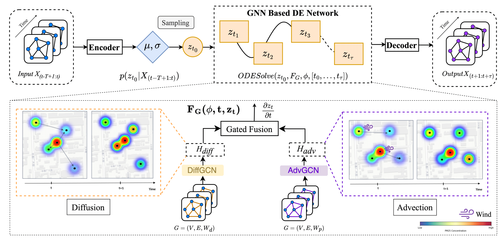

# AtmoFuseNet: Physics-Guided Neural Networks for Air Quality Prediction

AtmoFuseNet is a PyTorch-based deep learning framework implementing physics-guided differential equation neural networks for accurate air quality forecasting.

## Framework


## Requirements
* scipy>=1.5.2
* numpy>=1.19.1
* pandas>=1.1.5
* pyyaml>=5.3.1
* torch>=1.7.1
* future>=0.18.2
* torchdiffeq>=0.2.0
* haversine
* torch_geometric
* arrow

Install all dependencies using:
```bash
pip install -r requirements.txt
```

## Data Preparation
The air quality dataset files should be placed inside the `data/` directory:
- `data/station.csv`
- `data/train.npz`
- `data/val.npz`
- `data/test.npz`

Sample dataset files are available at [Google Drive](https://drive.google.com/drive/folders/1RWOA7kaPFAgjedoszOLCAjoQR1XSv8Dt).

## Model Training and Evaluation
To train and evaluate the model:
```bash
python main.py --config_filename config.yaml
```
